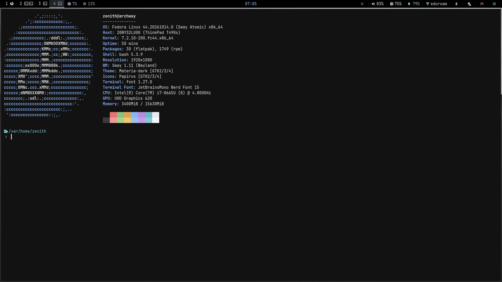

# SericeaPass

My personal Fedora 44 Sway Atomic image for development work as a computer science student.



Built around Sway and Wayland, with greetd and tuigreet for login. Includes my preferred packages for coding, terminal workflows, and everyday use, on top of Fedora's atomic desktop base.

Desktop tools include Thunar plugins, Zathura, mpv, wf-recorder, and wdisplays. Development and terminal tools include Git, GitHub CLI, Vim, tmux, Distrobox, Ansible, Helm, and the Kubernetes client.

Includes printing, fingerprint authentication, virtualization, and Waydroid packages, with TLP, acpid, and periodic SSD trimming enabled.

The image configuration and package list are in [`Containerfile`](Containerfile). GitHub Actions builds and publishes the image to `ghcr.io/nanda-kumudhan/my-sway:latest`.

## Waydroid

The image enables firewalld and the Waydroid container service. The `waydroid0`
bridge is assigned to firewalld's `trusted` zone, following the
[Waydroid networking instructions](https://docs.waydro.id/debugging/networking-issues).
Android can reach host services through this bridge; other interfaces keep their
existing zones. NetworkManager leaves the bridge to Waydroid, which manages its
DHCP, DNS, forwarding and NAT. The container service waits for firewalld and skips
startup until Waydroid has been initialized. Fedora's packaged kernel and
Waydroid dependencies provide binder support; SELinux stays enabled.

After booting the image, download and initialize Android once on the host
(the images and user data live in writable `/var`, outside the OS image):

```sh
sudo waydroid init
sudo systemctl start waydroid-container.service
waydroid session start
```

Run `waydroid show-full-ui` from another terminal in your Sway session to open
Android. Run the session and UI commands as your desktop user. To use Google
apps, choose `sudo waydroid init -s GAPPS` for the initial setup instead.

To check the container and firewall after initialization:

```sh
waydroid status
sudo firewall-cmd --get-zone-of-interface=waydroid0
sudo journalctl -u waydroid-container.service -b
```

The zone query should print `trusted`. On an existing installation, `/etc`
customizations may override image defaults; if necessary, apply the bridge zone
with `sudo firewall-cmd --permanent --zone=trusted --add-interface=waydroid0`,
then `sudo firewall-cmd --reload` and restart the Waydroid container service.

## Build locally

With Git and Podman installed:

```sh
git clone https://github.com/nanda-kumudhan/sericeapass.git
cd sericeapass
podman build -t sericeapass -f Containerfile .
```
